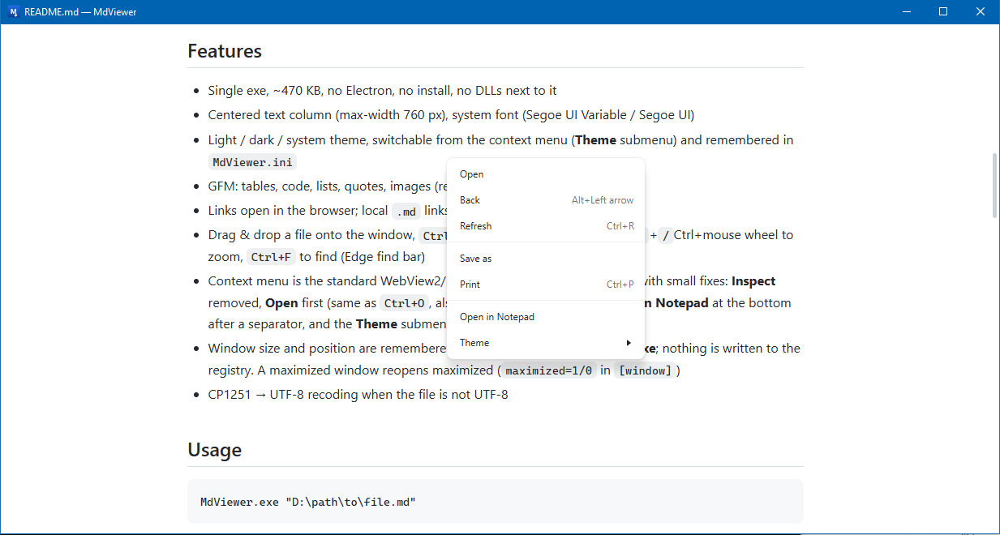
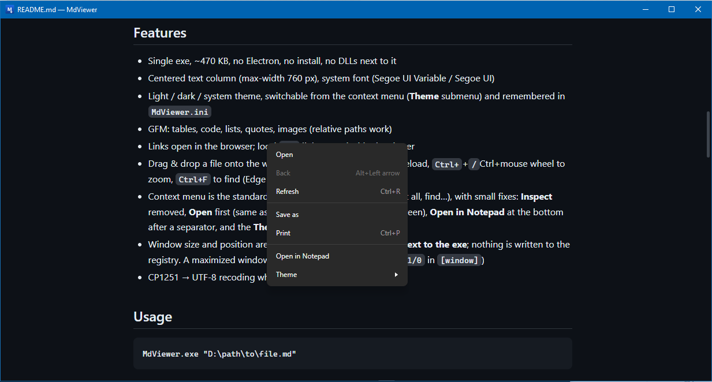

# CompactMdViewer

**Compact Markdown viewer for Windows: Win32 + WebView2 + md4c.**

I tried six or seven Markdown viewers and none of them fit — too heavy, too
slow, or an editor in disguise. So I wrote the viewer I wanted: a single
~470 KB exe, no Electron, no install, no DLLs next to it (static CRT, `/MT`).
It opens a `.md` file and gets out of the way.




## Features

- Single exe, ~470 KB, no Electron, no install, no DLLs next to it
- Centered text column (max-width 760 px), system font (Segoe UI Variable /
  Segoe UI)
- Light / dark / system theme, switchable from the context menu
  (**Theme** submenu) and remembered in `MdViewer.ini`
- GFM: tables, code, lists, quotes, images (relative paths work)
- Links open in the browser; local `.md` links open inside the viewer
- Drag & drop a file onto the window, `Ctrl+O` to open, `F5` to reload,
  `Ctrl+`+`/`Ctrl+mouse wheel to zoom, `Ctrl+F` to find (Edge find bar)
- Context menu is the standard WebView2/Edge one (copy, select all,
  find…), with small fixes: **Inspect** removed, **Open** first
  (same as `Ctrl+O`, also on the welcome screen) — but only on plain
  page or selected text, never over a link or an image, where it would
  mislead; **Open in Notepad** at the bottom after a separator, and
  the **Theme** submenu right below it
- Window size and position are remembered in **`MdViewer.ini` next to
  the exe**; nothing is written to the registry. A maximized window
  reopens maximized (`maximized=1/0` in `[window]`)
- CP1251 → UTF-8 recoding when the file is not UTF-8

## Usage

```
MdViewer.exe "D:\path\to\file.md"
```

No argument opens a welcome screen. You can also drag a `.md` file onto
the window. Settings live in `MdViewer.ini` next to the exe.

## Build

Prerequisites: **Visual Studio 2022** (C++ workload, x64) and the
**WebView2 Runtime** (already present on most Windows 10/11 machines).
Everything else the build needs is vendored in `third_party`
(md4c 0.5.3 sources, WebView2 SDK headers + loader lib) — no downloads.

### CLion (recommended)

1. **File | Open** → the `CompactMdViewer` folder.
2. Toolchain: **Visual Studio** (MSVC 2022, x64). CLion finds it itself;
   CMake and Ninja are the ones bundled with CLion.
3. One build profile: **Release** (Ninja generator, `cmake-build-release`).
4. **Build | Build Project** or `Ctrl+F9`.

A Release build is also copied to a deploy folder, but only if that folder
exists — see `cmake/copy-release.cmake` and the `MDVIEWER_DEPLOY` option
in `CMakeLists.txt`. A Debug build is never deployed, so it cannot
overwrite the working exe. The copy fails while an old exe is running
(file locked) — close MdViewer and rebuild (or copy by hand).

> A bare `cmake --build` from the command line needs the MSVC environment
> first — CLion sets it up itself; `build.sh` does the same from Git Bash.

## How it works

- `src/main.cpp` — the whole app: Win32 window, WebView2, md4c → HTML
  rendered into a temp file (`%TEMP%\MdViewer\preview.html`).
- `src/app.rc` / `src/app.ico` — the exe icon.
- `third_party/wv2` — WebView2 SDK 1.0.4370.26 (headers + static loader).
  Only the files the build uses are in the repo; the rest of the NuGet
  package (runtimes for other architectures, .NET assemblies) is not
  needed.
- `third_party/md4c` — md4c 0.5.3 (only `src/` is in the repo; tests and
  tools are not needed to build).
- `build.sh` — one-command build from Git Bash (MSVC via `vcvarsall`).

### Theme (light / dark / system)

The page theme comes from `@media (prefers-color-scheme: dark)` in the CSS
and `profile->put_PreferredColorScheme` in WebView2; the dark title bar is
`DwmSetWindowAttribute` (`DWMWA_USE_IMMERSIVE_DARK_MODE`), the background
behind the page is `ICoreWebView2Controller2::put_DefaultBackgroundColor`.
The theme is picked in the context menu (**Theme** → Light / Dark /
System), applied immediately (`ApplyTheme()` in `src/main.cpp`: the same
logic as at startup, plus re-rendering the current file) and saved to ini
as `[window] theme=system|light|dark` (default `system`). An explicit menu
choice beats the `MDVIEWER_DARK=1` environment variable (kept for testing);
in `system` mode the variable still works, and the system setting comes
from the `AppsUseLightTheme` registry value. The checkmark on the current
theme uses `COREWEBVIEW2_CONTEXT_MENU_ITEM_KIND_CHECK_BOX`: on a plain
`COMMAND` item `IsChecked` is silently ignored and there is no checkmark.

### Custom context-menu items

The menu is the standard WebView2 one, adjusted in `ContextMenuRequested`
(`src/main.cpp`, `SetupWebView`):

- **Inspect** is removed; DevTools stay enabled (`F12` / `Ctrl+Shift+I`
  still work).
- **Open in Notepad** is at the bottom, after a separator; only when a
  file is open.
- **Open** is the first item, the same as `Ctrl+O`; only on plain page or
  selected text, never over a link or an image.
- **Theme** is a submenu right below **Open in Notepad**, with no
  separator between them.

To add another item: one more `CreateContextMenuItem` +
`InsertValueAtIndex` in the same handler.

### Why Ctrl+O goes through a hook, not WebView2

`Ctrl+O` / `F5` are caught by a low-level keyboard hook (`WH_KEYBOARD_LL`
in `src/main.cpp`), with an accelerator table as a backup. WebView2 does
not deliver them: `ICoreWebView2Controller::add_AcceleratorKeyPressed`
never fires for `Ctrl+O`, `F5` or `Ctrl+F` — re-checked live 2026-11-25
with the hook and the table disabled, the event log stayed empty. Do not
rewrite it back to `AcceleratorKeyPressed` — it does not work.

## Support

If CompactMdViewer saves you time, you can [support its development](https://donatello.to/ilwsm) — one-time, any amount. Crypto (USDT and others) and cards are accepted.

## License

MIT — see [LICENSE](LICENSE). If you use it, a star is welcome, and
issues and pull requests are too.
